# Exact Stage-3 request sent to GPT-6 Astra
_Episode: seed 0, --plan-source stage2 --obj; step 21. Images were sent as base64 JPEGs; here they are linked by file._

## Request parameters
```
model=gpt-6-astra  tool_choice=required  parallel_tool_calls=false
reasoning={effort: low, summary: auto}  store=false  (no temperature/top_p)
```

## instructions (system)

You control a single robot arm by calling exactly ONE motor primitive (tool) per turn. After each call the primitive runs to completion in the real environment, and you receive a fresh observation with the primitive's return values. You then choose the next call. Your calls continue until the task is done or the step budget (24 calls) runs out.

TASK
Lift the plate above the table.

ROBOT
Single Franka Panda 7-DoF arm on a fixed base, with a parallel-jaw gripper: two fingers, maximum opening 0.08 m, no suction. Wrist force/torque sensor and fingertip tactile pads.

ROBOT REFERENCE
Coordinates: world frame, metres. +x = away from the robot base toward the far side of the table (rightward in exo_right_cam, leftward in exo_left_cam). +y = the robot's left, toward exo_left_cam (−y is toward exo_right_cam). +z = up. Table surface z ≈ 0.80 m. Safe transit height ≈ 0.95 m. Grasp/place heights ≈ 0.81–0.86 m for the gripper point when touching objects on the table (with the gripper pointing down, below ≈0.808 m the fingertips press into the table). The reported gripper position is the point between the finger pads; with the gripper pointing down, the fingertips reach about 0.008 m below it.
Orientation is roll/pitch/yaw in degrees, EXTRINSIC X-Y-Z about the fixed world axes (roll about world x, then pitch about world y, then yaw about world z), the same convention as in your observation. The gripper pointing straight down = rpy (180, 0, 0) (roll ±180 are the same). In that pose the jaws open and close along world y, and changing yaw turns the jaw axis about world z. In general the jaws close along the gripper's own y-axis, and the fingers point along its own z-axis.
How MOVE_EEF moves: it drives the gripper in a STRAIGHT LINE from the current pose to the target pose, with position and orientation changing together, using a proportional controller that is fast when far and slows near the goal (max ≈ 0.003 m and 0.6° of actual motion per control step; 100 control steps = 1 s, so a 10 cm move takes about 70 steps and a 90° yaw about 240 steps). It stops when within 5 mm and 5° of the target, or when max_steps runs out. If you omit orientation (null), the current orientation is held. It does NOT plan around obstacles and does NOT stop on contact: if the line passes through the table or an object, the gripper presses against it or pushes it.
Use this deliberately for pushing/sliding: lower the closed fingertips to just above the table surface beside the object and drive the straight line through the object's SIDE face in the direction you want it to move. Pressing down on an object's top face and dragging does NOT slide it here, because the fingertips and the table have the same friction. Avoid this effect otherwise: go up to the safe height first, move, then descend.
The gripper keeps its last OPEN/CLOSE state during every move. After each primitive you receive the achieved pose, the remaining error, whether it converged, and the peak contact force. Check these and correct with another move if needed. Near the edge of the reachable workspace, or for unusual orientations, MOVE_EEF can stall (converged=false). If it does, try reaching the pose from a different intermediate position or orientation.
LIFT/DESCEND: vertical moves that keep x, y and orientation. ATOMIC_ACTION: raw normalised 7D delta [dx,dy,dz,droll,dpitch,dyaw,grip] in [−1,1] for n ticks. 1.0 ≈ 0.003 m / 0.6° of motion per tick when held (the command is a target offset of up to 0.05 m / 28.6° that the arm cannot cover in one tick). Use it only for fine nudges. HOLD waits. Call DONE only when you believe the plate is lifted above the table.
Common failure modes: trying a top-down grasp on the flat plate (fingers can't get under it); losing contact while sliding (the plate stays put); sliding too far (the plate falls off); lifting before the lip overhangs enough for the finger pads.

PLAN
A PLAN block is given in each observation. Treat it as guidance: follow its sub-goals in order, keep track of which sub-goal is active, and deviate only with a reason stated in your reasoning. Report the active sub-goal id and its status on every call.

EVERY CALL
Call exactly one tool. Fill in: reasoning (what you see, what the last result tells you, and why this call), description (one line), active_subgoal_id (the plan sub-goal you are working on, or "none" if there is no plan), subgoal_status (in_progress | achieved | abandoned), and params (in the units named by each field).


## input: user message, step 21 (content parts in order)

PLAN
Plan produced by the Stage-2 planner for this scene (seed 0, sample 0).

1. [S1] Unloaded hand in verified free space with calibrated motion and sensing references
   physical outcome: The plate remains undisturbed while the hand stays inside a conservatively observed free-space envelope. Stationary observations and joint/pose feedback, followed only by bounded no-contact checks within that envelope, establish the actual motion-frame relationship and jaw response.
   preconditions: The plate is flat and fully supported by the table.; The hand is visibly separated from the plate, nearly open, and has zero fingertip tactile readings; the raw wrist wrench is not treated as plate contact (cam:exo_left_cam:f0; meta:sensor_snapshot.0).
   postconditions: Base-frame translation and rotation responses are registered to the observed world-frame pose; actual finger motion confirms that -1 opens and +1 closes the hand.; Actual motion remains within verified clearance. Subsequent movements are feedback-bounded deltas, not absolute poses or assumed displacements: full-scale targets represent 0.05 m and 0.5 rad per update at 100 Hz (meta:controller_interface.controller; meta:controller_interface.action_space.scaling; meta:controller_interface.action_space.gripper; meta:controller_interface.control_frequency_hz).; An unloaded wrench and tactile reference is recorded for the current orientation and hand configuration, without assuming gravity compensation or zero sensor bias.
   constraints: C5, C6, C7, C8
2. [S2] Supported plate and surrounding geometry exposed for metric verification
   physical outcome: The hand occupies reachable, collision-free observation poses while the plate remains fully supported. External and wrist RGB views at known hand poses establish conservative metric bounds using measured jaw opening as a scale reference.
   preconditions: The hand is unloaded, with the motion-frame relationship established in S1.; Observation movements remain inside successively verified free-space volumes; no underside access is assumed.
   postconditions: Plate width, visible thickness, sidewall engagement height, fingertip dimensions, and palm envelope are bounded sufficiently to compare candidate pinches against the 0.08 m aperture, including insertion allowance and measurement uncertainty (meta:sensor_snapshot.0.gripper_opening_m; meta:controller_interface.end_effector).; Table height, perimeter, plate-to-edge distances, and the supported plate footprint are localized from side and wrist views with proprioception. Ambiguous surface locations are refined only by bounded contact observations after a safe approach is established.; A direct grasp is admissible only if its opposed span and table-clear sidewall engagement are positively verified. Hidden underside shape and actual under-edge clearance remain explicit checks to perform after exposure.
   constraints: C1, C2, C4, C5, C6, C8
3. [S3] Reachable grasp staging poses and a safe support-return corridor
   physical outcome: The empty hand reaches verified staging poses for a selected grasp route without disturbing the plate. Required hand orientations are checked in genuinely clear space, including the complete arm, palm, and finger swept volumes.
   preconditions: The plate remains fully supported and the hand is unloaded.; S2 provides bounded object, table, and hand geometry; frame registration is established.
   postconditions: Joint/end-effector feedback and camera clearance checks establish a continuous fixed-base route through approach, engagement, near-table lifting, and return to support. Neither the current overhead pose nor an elevated rehearsal alone certifies low edge access.; If a full-width, table-clear grasp is verified, S4-S6 are omitted and execution continues to S7. Otherwise, a reachable perimeter and supported translation corridor are selected for the smallest potentially useful overhang; actual stability and underside access remain gated by S5-S6.; Pose-appropriate unloaded wrench references are obtained for the intended contact and grasp orientations. If no feasible route is verified, the plate remains supported rather than being moved toward an unusable edge.
   constraints: C1, C2, C4, C5, C6, C7, C8
4. [S4] Small, controllable plate translations with full table support
   physical outcome: For the edge route only, bounded contact trials produce and stop small in-plane plate motions while it remains well inboard. These trials identify a usable same-hand repositioning contact and its local traction, resistance, and rotation response. Upper-face contact is used only for repositioning or stabilization, never as a lifting attachment.
   preconditions: The edge route is selected, with a reachable contact pose and clear translation corridor.; The plate has enough fully supported travel for the bounded trials, and an unloaded reference exists for the contact orientation.
   postconditions: Camera-tracked plate displacement is correlated with corrected wrist wrench and tactile response, distinguishing plate sliding from finger slip, sticking, or table obstruction.; Small translations can be stopped without uncontrolled rotation or tipping; conservative progression and stopping limits are established rather than assuming friction values.; The same hand can maintain a suitable stabilizing contact during the forthcoming support reduction. If this cannot be demonstrated, no edgeward progression occurs.
   constraints: C1, C4, C5, C6, C7, C8
5. [S5] Minimal candidate overhang stabilized by the table and the same hand
   physical outcome: For the edge route only, the plate advances toward the selected perimeter in small, observed increments until a candidate lower-finger access region projects beyond the table. Remaining table contact and the same hand continuously stabilize the plate; the hand is not yet released for reorientation.
   preconditions: S4 has demonstrated controllable motion and an available stabilizing contact.; The intended overhang, contact path, and retreat toward greater table support lie within the verified reachable corridor.
   postconditions: The actual plate pose, remaining supported footprint, and overhang are measured after each increment; progression stops at the least candidate overhang needed for useful finger engagement.; Corrected contact loads, moments, and visual response during incremental support changes provide local stability evidence. Advancement is allowed only while table support and the same hand retain control; the geometric center is not assumed to be the center of mass.; The plate remains stabilized, with a route back toward greater support available. Apparent overhang alone is not yet accepted as verified underside clearance or permission to withdraw the hand.
   constraints: C2, C4, C5, C6, C7, C8
6. [S6] Self-stable exposed edge with an open hand aligned across its thickness
   physical outcome: For the edge route only, the stabilizing hand load is progressively removed without first breaking contact. Only after tabletop-alone stability is demonstrated does the hand withdraw, obtain underside views, and reach an open top/bottom grasp alignment through verified free space.
   preconditions: S5 has produced a measured overhang while the table and hand still stabilize the plate.; The hand can restore greater support if the stability or clearance checks fail.
   postconditions: Bounded unloading and stability checks, using corrected wrench and observed plate response, establish a conservative restoring/support margin before hand withdrawal. Mere lack of visible motion or an assumed centered mass is insufficient; unresolved stability requires restoring support.; New side and wrist views establish the real underside shape, finger-sized gap, insertion depth, and usable contact thickness. These fit the jaw opening and leave clearance for fingertips, palm, and table sidewall, including uncertainty.; After clearance-preserving reorientation, the open hand has one finger above and one below the exposed region, without table interference. The plate remains stable without a second hand, and a comparable unloaded wrench reference is available before engagement.
   constraints: C1, C2, C4, C5, C6, C7, C8
7. [S7] Opposed contacts genuinely capture the plate while table support remains
   physical outcome: The hand establishes opposed plate contacts without removing tabletop support: opposite sidewalls on the verified direct route, or the top and underside of the exposed edge on the edge route.
   preconditions: Either S2-S3 verify an accessible full-width grasp, or S6 supplies a self-stable exposed edge and verified top/bottom access.; The required span and insertion clearance fit the aperture, and the hand has a collision-free approach and supported-return path.
   postconditions: Both tactile arrays, actual finger positions, and camera views agree that the jaws contact the plate rather than trapping or pressing against the table.; Contact locations and pad overlap are sufficient candidates for resisting the expected cantilever moment, not merely a shallow corner touch. Closure remains bounded by observed contact response.; The plate remains supported and geometrically captured, but full load and moment capacity are explicitly not yet assumed.
   constraints: C1, C2, C3, C4, C5, C6, C7, C8
8. [S8] Full plate load carried in a reversible near-table proof lift
   physical outcome: The opposed contacts progressively take the plate's load while the plate stays close to its verified return-to-support position. Only while contact remains stable does this progress to a small whole-plate separation and near-static proof hold.
   preconditions: S7 verifies real opposed plate contacts; table support is still available.; A pose-appropriate unloaded wrench reference and a collision-free, immediate return to the previously stable supported pose are available.
   postconditions: Corrected wrist force and torque, tactile changes, and camera-observed motion establish the supported weight, center-of-mass-related moment, and local slip/rotation behavior during support transfer.; At the proof hold, the whole plate is off the table and the hand carries its complete load without observed creep or unwanted rotation. Partial unloading or one raised corner is not accepted as full-load evidence.; The tested contact configuration supports the intended slow lift and hold; no capacity is inferred for untested rotations or accelerations. If engagement or moment capacity is inadequate, the plate is reseated before any relaxation or regrasp.
   constraints: C3, C4, C5, C6, C7, C8
9. [S9] Whole plate stably held above the tabletop
   physical outcome: The plate is held in the tested grasp with a positive clearance from the table that exceeds observation uncertainty. Only enough additional elevation to establish an unambiguous, stable lift is used; no numerical lift height is assumed.
   preconditions: S8 demonstrates whole-plate load support without slip or unwanted rotation.; The upward swept volume and return-to-support path remain clear and reachable.
   postconditions: Multiple camera views establish that the entire plate, not merely one corner, has cleared the tabletop and moves with the hand.; Tactile engagement, actual jaw position, and baseline-corrected wrist load remain consistent with sustained plate retention rather than empty-hand motion or table contact.; The plate remains stably suspended. Any emerging slip or rotation triggers controlled return to verified table support before the hand is opened.
   constraints: C3, C4, C5, C6, C7, C8

Constraints referenced by the plan:
- C1: The direct full-width top-down pinch is likely aperture-infeasible: the plate appears broader than the 0.08 m maximum opening, although metric confirmation is needed. Any pinch must fit both the opposed contact span and insertion clearance within the hand opening. With no suction or visible top grasp feature, upper-face contact alone cannot substitute for a lifting attachment.
- C2: The tabletop obstructs lower-finger access while the plate remains apparently flush and fully inboard. A thickness pinch or underside-supported lift requires a real finger-sized edge clearance. If a full-width pinch does not fit, the plate/table support geometry must expose a narrower accessible contact region, such as an overhanging or raised edge, before that alternative can work.
- C3: A controlled lift requires hand contacts that carry the plate's weight and resist slip or rotation after table support disappears. Geometric engagement alone does not establish adequate load capacity; friction, contact orientation, and engagement matter. Success requires the plate itself to leave the tabletop, not merely a raised wrist or one raised corner with continued table support.
- C4: Any reduction of tabletop support must retain stability through the remaining table contact and/or the same hand. Excessive overhang or poorly controlled tilt could cause a drop rather than useful edge access. There is no second arm to stabilize the plate, and the stationary capture provides no evidence of the friction or force thresholds governing controlled movement.
- C5: Finger and palm swept volumes must respect the tabletop and plate geometry, especially during low approaches and hand rotation. Free space above the plate does not imply sideways or underside clearance. Controlled table contact may be usable, but table obstruction must not be mistaken for plate capture; exact clearances are unmeasured.
- C6: Any required edge-access position and hand orientation must be reachable by the single fixed-base arm without unintended interference with the table. The current overhead pose shows access to this part of the workspace, but does not certify reachability of a lateral or under-edge configuration.
- C7: There is no demonstrated initial grasp: the hand is nearly fully open, both tactile readings are zero, and the images show separation. The nonzero raw wrist wrench cannot by itself establish contact or load support. Grasp and lift verification must distinguish actual plate engagement from table contact, sensor baseline, and empty-hand motion.
- C8: Control uses base-frame pose deltas, whereas the position observable is in world coordinates; their relationship must be established rather than assumed. At 100 Hz, normalized full-scale commands correspond to target increments of 0.05 m and 0.5 rad, not absolute poses or guaranteed clearance-safe motions. Gripper sign is -1 open and +1 closed. Close-contact feasibility depends on correct frames, signs, and clearance-resolved increments.

FRAME HISTORY: the last 12 observation batches before now, oldest first (low resolution).

[history: start of step 9]

  _(image, detail=low)_

  _(image, detail=low)_

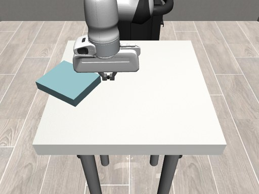  _(image, detail=low)_

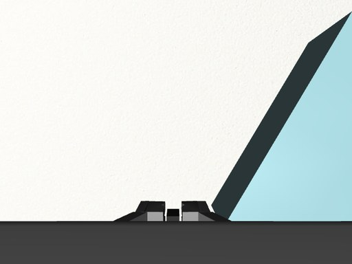  _(image, detail=low)_

[history: start of step 10]

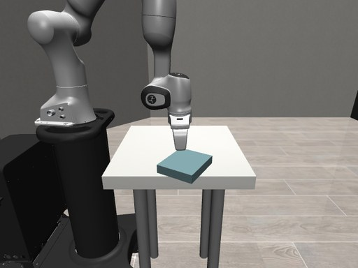  _(image, detail=low)_

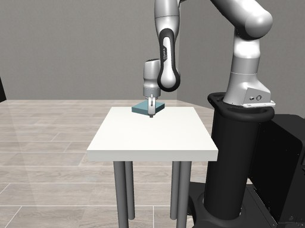  _(image, detail=low)_

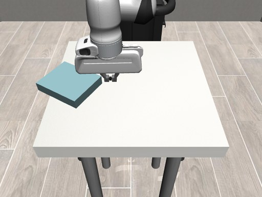  _(image, detail=low)_

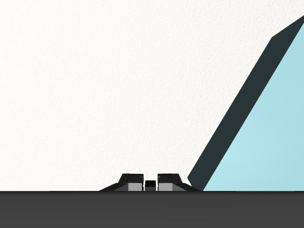  _(image, detail=low)_

[history: start of step 11]

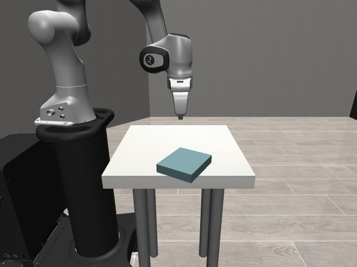  _(image, detail=low)_

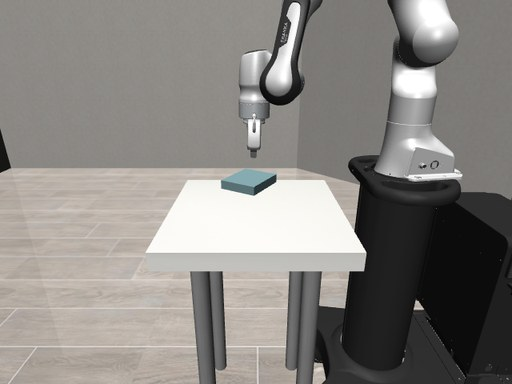  _(image, detail=low)_

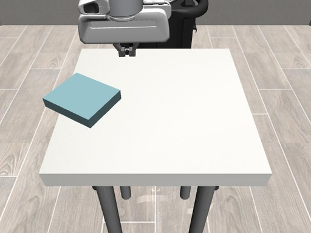  _(image, detail=low)_

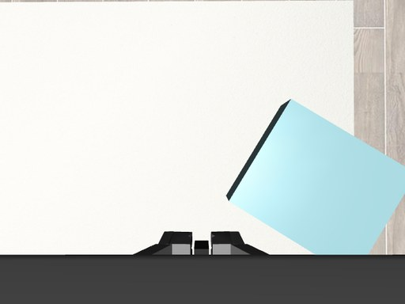  _(image, detail=low)_

[history: start of step 12]

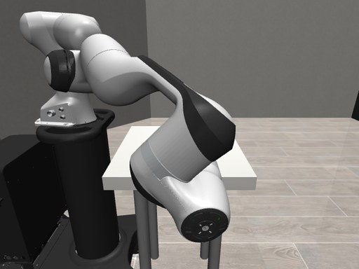  _(image, detail=low)_

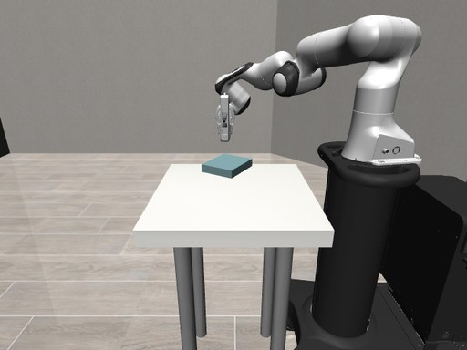  _(image, detail=low)_

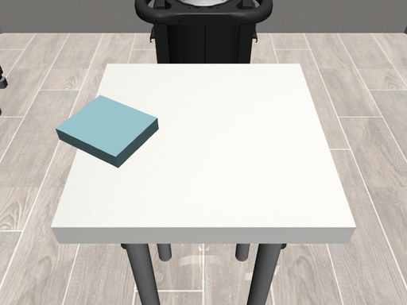  _(image, detail=low)_

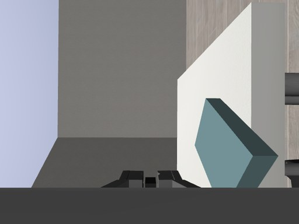  _(image, detail=low)_

[history: start of step 13]

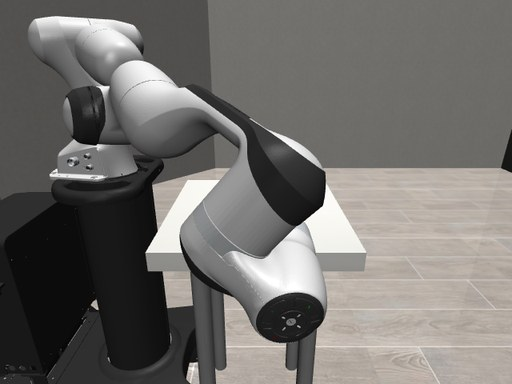  _(image, detail=low)_

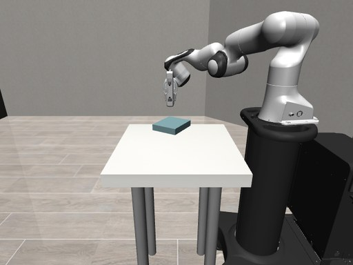  _(image, detail=low)_

  _(image, detail=low)_

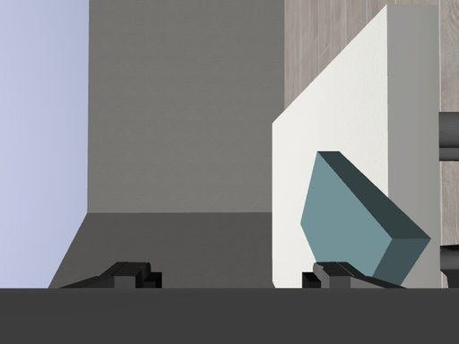  _(image, detail=low)_

[history: start of step 14]

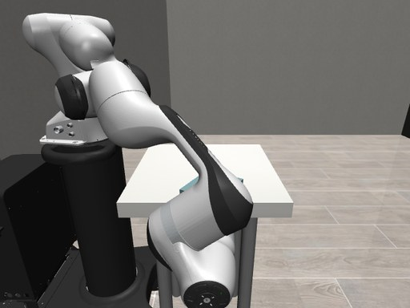  _(image, detail=low)_

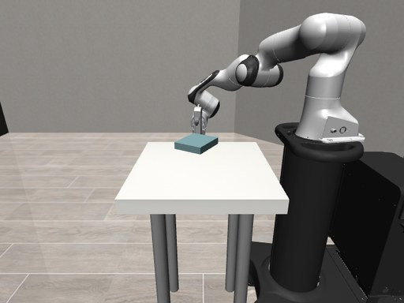  _(image, detail=low)_

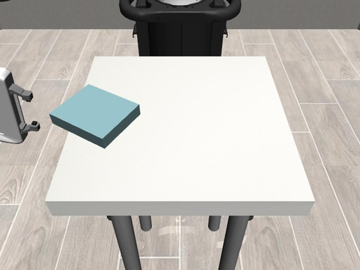  _(image, detail=low)_

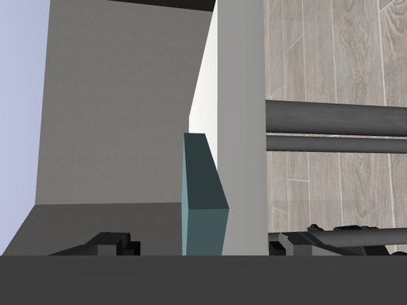  _(image, detail=low)_

[history: start of step 15]

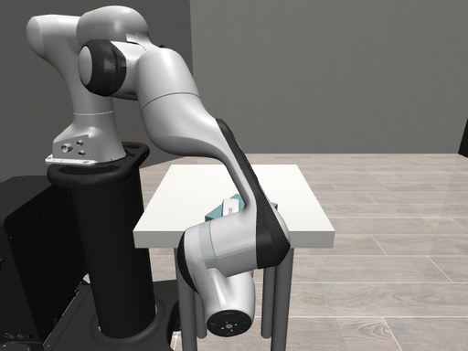  _(image, detail=low)_

  _(image, detail=low)_

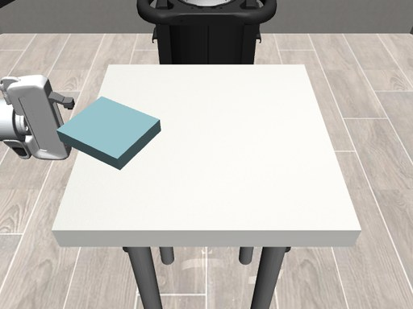  _(image, detail=low)_

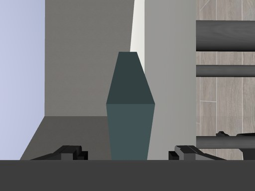  _(image, detail=low)_

[history: start of step 16]

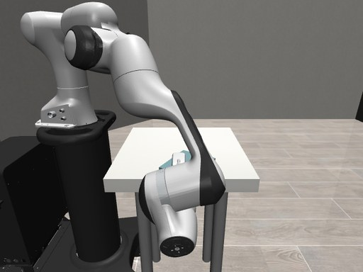  _(image, detail=low)_

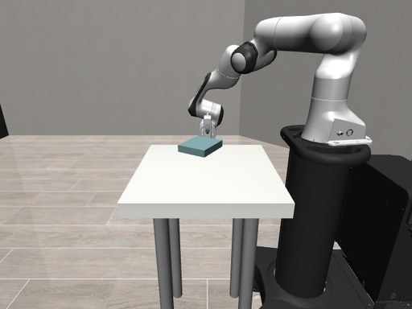  _(image, detail=low)_

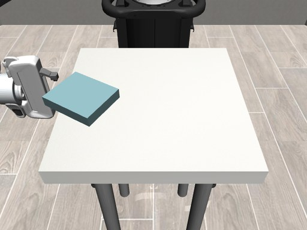  _(image, detail=low)_

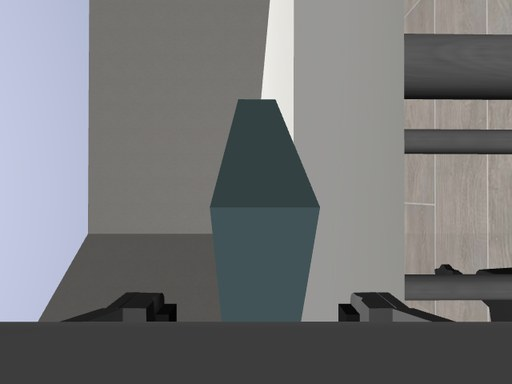  _(image, detail=low)_

[history: start of step 17]

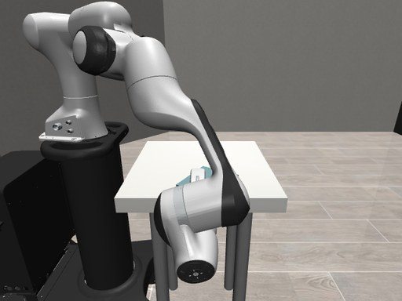  _(image, detail=low)_

  _(image, detail=low)_

  _(image, detail=low)_

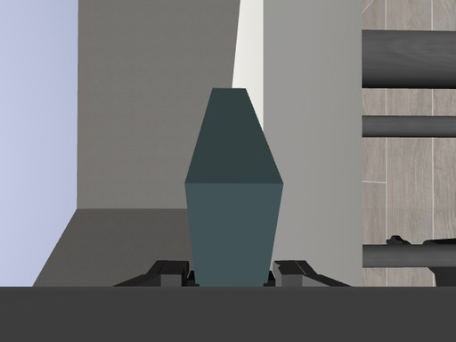  _(image, detail=low)_

[history: start of step 18]

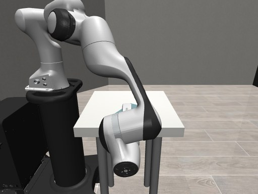  _(image, detail=low)_

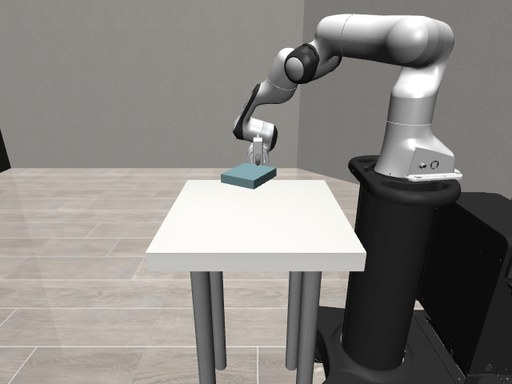  _(image, detail=low)_

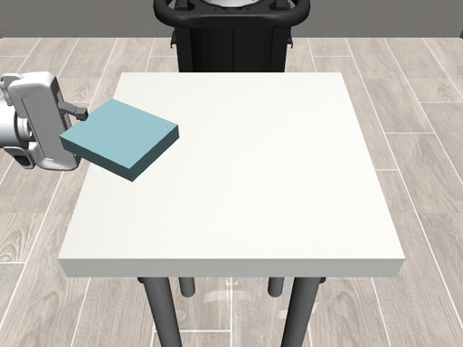  _(image, detail=low)_

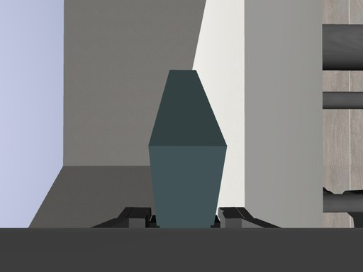  _(image, detail=low)_

[history: start of step 19]

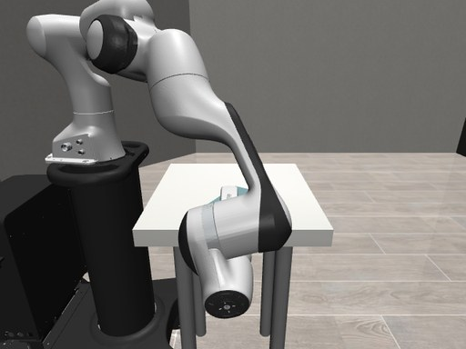  _(image, detail=low)_

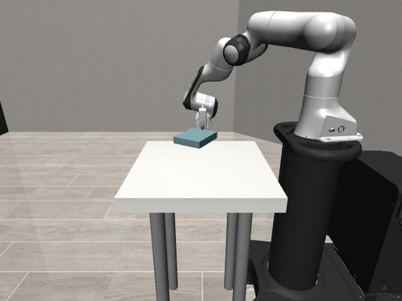  _(image, detail=low)_

  _(image, detail=low)_

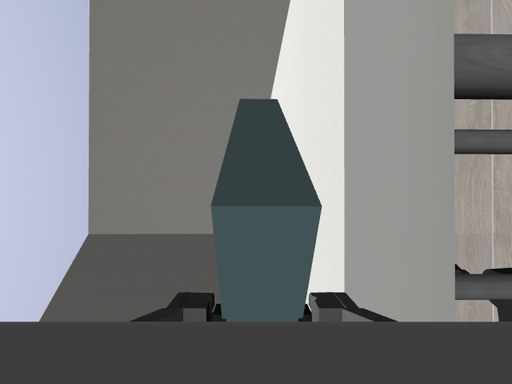  _(image, detail=low)_

[history: start of step 20]

  _(image, detail=low)_

  _(image, detail=low)_

  _(image, detail=low)_

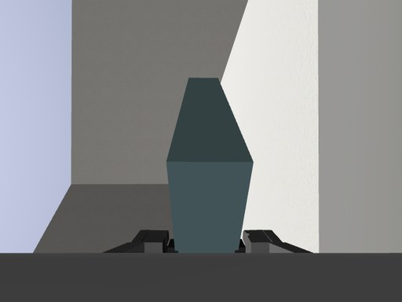  _(image, detail=low)_

CURRENT OBSERVATION
step: "21 of 24"
elapsed_control_steps: 1744
elapsed_s: 17.44
robot_state:
  eef_pos_m: [-0.007, -0.263, 0.867]
  eef_quat_xyzw: [0.714, -0.002, 0.003, -0.7]
  eef_rpy_deg: [-91.1, -0.0, -0.4]
  gripper_opening_m: 0.0399
  gripper_openness_frac: 0.499
  gripper_command_register: "closed"
  ft_sensor_frame: {"force_N": [6.18, 0.0, -0.11], "torque_Nm": [-0.002, 0.894, -0.029]}
  ft_world_force_N: [-0.0, 0.0, 6.18]
  tactile_max: {"left": 0.741, "right": 0.683}
camera_calibration:
  gripper_cam: {"position_m": [0.042, -0.361, 0.869], "view_direction": [0.007, 1.0, -0.019], "image_up_direction": [1.0, -0.007, 0.001], "fovy_deg": 75.0, "resolution": [640, 480]}
  ego_cam: {"position_m": [0.59, 0.0, 1.312], "view_direction": [-0.708, -0.0, -0.706], "image_up_direction": [-0.706, 0.0, 0.708], "fovy_deg": 45.0, "resolution": [640, 480]}
  exo_right_cam: {"position_m": [0.0, -0.9, 1.2], "view_direction": [-0.0, 0.932, -0.363], "image_up_direction": [0.0, 0.363, 0.932], "fovy_deg": 60.0, "resolution": [640, 480]}
  exo_left_cam: {"position_m": [0.0, 0.9, 1.2], "view_direction": [-0.0, -0.932, -0.363], "image_up_direction": [0.0, -0.363, 0.932], "fovy_deg": 60.0, "resolution": [640, 480]}
objects:
  plate: {"position_m": [0.022, -0.194, 0.863], "rpy_deg": [0.1, -0.7, -120.8], "extents_m": [0.155, 0.13, 0.03]}
  table: {"top_surface_z_m": 0.8, "center_xy_m": [0.0, 0.0], "extents_m": [0.5, 0.5, 0.05], "edges": {"x_min": -0.25, "x_max": 0.25, "y_min": -0.25, "y_max": 0.25}}

[current view: exo_right_cam]

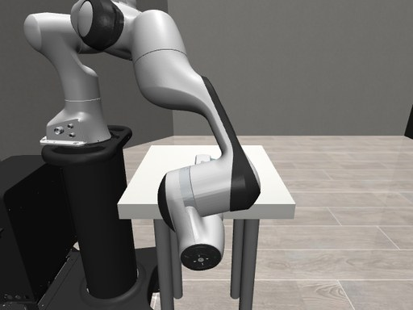  _(image, detail=high)_

[current view: exo_left_cam]

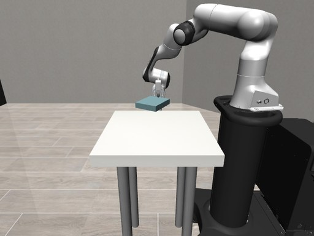  _(image, detail=high)_

[current view: ego_cam]

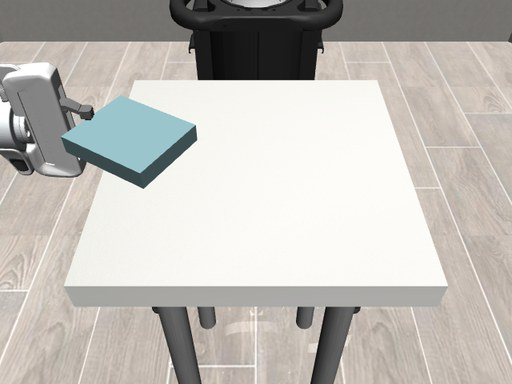  _(image, detail=high)_

[current view: gripper_cam]

  _(image, detail=high)_

WORKING MEMORY (last 12 of at most 12 steps, oldest first):
- step 9: state before: eef [0.006, -0.07, 0.82] rpy [-179.2, -1.4, 0.3] gripper 0.01 m
  called MOVE_EEF {"position_m": [0.006, -0.062, 0.82], "orientation_rpy_deg": null, "max_steps": 60}
  result: {"converged": true, "steps": 28, "final_position_m": [0.0059, -0.0667, 0.8201], "final_rpy_deg": [-179.02, -1.41, 0.47], "position_error_mm": 4.66, "orientation_error_deg": 0.23, "peak_force_N": 6.3, "contact": true}
  reward change: +0.000
- step 10: state before: eef [0.006, -0.067, 0.82] rpy [-179.0, -1.4, 0.5] gripper 0.01 m
  called LIFT {"dz_m": 0.13}
  result: {"converged": true, "steps": 83, "final_position_m": [0.0074, -0.0679, 0.9476], "final_rpy_deg": [-178.9, -1.09, 0.55], "position_error_mm": 3.18, "orientation_error_deg": 0.36, "peak_force_N": 2.24, "contact": true}
  reward change: +0.000
- step 11: state before: eef [0.007, -0.068, 0.948] rpy [-178.9, -1.1, 0.5] gripper 0.01 m
  called MOVE_EEF {"position_m": [0.04, -0.36, 0.95], "orientation_rpy_deg": [-90.0, 0.0, 0.0], "max_steps": 300}
  result: {"converged": true, "steps": 218, "final_position_m": [0.0381, -0.3609, 0.9502], "final_rpy_deg": [-91.35, -0.31, -0.33], "position_error_mm": 2.15, "orientation_error_deg": 1.43, "peak_force_N": 4.34, "contact": true}
  reward change: +0.000
- step 12: state before: eef [0.038, -0.361, 0.95] rpy [-91.4, -0.3, -0.3] gripper 0.01 m
  called OPEN_GRIPPER {}
  result: {"finger_width_m": 0.0771, "ticks": 45, "object_between_fingers": false, "tactile_max": 0.0}
  reward change: +0.000
- step 13: state before: eef [0.038, -0.361, 0.953] rpy [-91.7, -0.1, -0.6] gripper 0.0771 m
  called DESCEND {"target_z_m": 0.815}
  result: {"converged": false, "steps": 400, "final_position_m": [0.0259, -0.3389, 0.8249], "final_rpy_deg": [-97.46, -0.98, -4.65], "position_error_mm": 26.57, "orientation_error_deg": 7.13, "peak_force_N": 5.45, "contact": false}
  reward change: +0.000
- step 14: state before: eef [0.026, -0.339, 0.825] rpy [-97.5, -1.0, -4.6] gripper 0.0789 m
  called MOVE_EEF {"position_m": [-0.005, -0.274, 0.815], "orientation_rpy_deg": [-90.0, 0.0, 0.0], "max_steps": 160}
  result: {"converged": true, "steps": 106, "final_position_m": [-0.0059, -0.2726, 0.8167], "final_rpy_deg": [-90.65, -0.08, -0.3], "position_error_mm": 2.37, "orientation_error_deg": 0.73, "peak_force_N": 4.95, "contact": false}
  reward change: +0.000
- step 15: state before: eef [-0.006, -0.273, 0.817] rpy [-90.7, -0.1, -0.3] gripper 0.0789 m
  called MOVE_EEF {"position_m": [-0.006, -0.264, 0.815], "orientation_rpy_deg": [-90.0, 0.0, 0.0], "max_steps": 70}
  result: {"converged": true, "steps": 27, "final_position_m": [-0.0069, -0.2645, 0.817], "final_rpy_deg": [-90.79, -0.08, -0.33], "position_error_mm": 2.22, "orientation_error_deg": 0.86, "peak_force_N": 0.74, "contact": false}
  reward change: +0.000
- step 16: state before: eef [-0.007, -0.265, 0.817] rpy [-90.8, -0.1, -0.3] gripper 0.0789 m
  called CLOSE_GRIPPER {}
  result: {"finger_width_m": 0.0398, "ticks": 32, "object_between_fingers": true, "tactile_max": 0.8399}
  reward change: +0.000
- step 17: state before: eef [-0.007, -0.264, 0.818] rpy [-91.1, -0.1, -0.4] gripper 0.0398 m
  called LIFT {"dz_m": 0.025}
  result: {"converged": true, "steps": 52, "final_position_m": [-0.007, -0.2641, 0.84], "final_rpy_deg": [-90.9, -0.03, -0.36], "position_error_mm": 2.8, "orientation_error_deg": 0.19, "peak_force_N": 4.8, "contact": true}
  reward change: +0.000
- step 18: state before: eef [-0.007, -0.264, 0.84] rpy [-90.9, -0.0, -0.4] gripper 0.0399 m
  called HOLD {"n_ticks": 100}
  result: {"ticks": 100, "drift_mm": 0.52}
  reward change: +0.000
- step 19: state before: eef [-0.007, -0.264, 0.84] rpy [-91.0, -0.1, -0.4] gripper 0.0399 m
  called LIFT {"dz_m": 0.03}
  result: {"converged": true, "steps": 57, "final_position_m": [-0.0072, -0.2637, 0.8676], "final_rpy_deg": [-91.02, -0.01, -0.38], "position_error_mm": 2.15, "orientation_error_deg": 0.05, "peak_force_N": 3.66, "contact": true}
  reward change: +0.000
- step 20: state before: eef [-0.007, -0.264, 0.868] rpy [-91.0, -0.0, -0.4] gripper 0.0399 m
  called HOLD {"n_ticks": 100}
  result: {"ticks": 100, "drift_mm": 0.5}
  reward change: +0.000

Choose the next primitive.

## tools (8 strict function schemas)
```json
[
 {
  "type": "function",
  "name": "MOVE_EEF",
  "description": "Move the gripper in a straight line to a target pose (position + optional orientation).",
  "strict": true,
  "parameters": {
   "type": "object",
   "additionalProperties": false,
   "required": [
    "reasoning",
    "description",
    "active_subgoal_id",
    "subgoal_status",
    "params"
   ],
   "properties": {
    "reasoning": {
     "type": "string",
     "description": "why this primitive and these values, given the observation and the last results"
    },
    "description": {
     "type": "string",
     "description": "one line: what this call should achieve"
    },
    "active_subgoal_id": {
     "type": "string",
     "description": "plan sub-goal being worked on, or 'none'"
    },
    "subgoal_status": {
     "type": "string",
     "enum": [
      "in_progress",
      "achieved",
      "abandoned"
     ]
    },
    "params": {
     "type": "object",
     "additionalProperties": false,
     "required": [
      "position_m",
      "orientation_rpy_deg",
      "max_steps"
     ],
     "properties": {
      "position_m": {
       "type": "array",
       "items": {
        "type": "number"
       },
       "description": "target gripper position [x, y, z], metres, world frame"
      },
      "orientation_rpy_deg": {
       "type": [
        "array",
        "null"
       ],
       "items": {
        "type": "number"
       },
       "description": "target [roll, pitch, yaw] in degrees, extrinsic XYZ about world axes; null = keep the current orientation"
      },
      "max_steps": {
       "type": "integer",
       "description": "control-step budget (100 steps = 1 s), e.g. 300"
      }
     }
    }
   }
  }
 },
 {
  "type": "function",
  "name": "CLOSE_GRIPPER",
  "description": "Close the parallel jaws (holds the current pose while closing).",
  "strict": true,
  "parameters": {
   "type": "object",
   "additionalProperties": false,
   "required": [
    "reasoning",
    "description",
    "active_subgoal_id",
    "subgoal_status",
    "params"
   ],
   "properties": {
    "reasoning": {
     "type": "string",
     "description": "why this primitive and these values, given the observation and the last results"
    },
    "description": {
     "type": "string",
     "description": "one line: what this call should achieve"
    },
    "active_subgoal_id": {
     "type": "string",
     "description": "plan sub-goal being worked on, or 'none'"
    },
    "subgoal_status": {
     "type": "string",
     "enum": [
      "in_progress",
      "achieved",
      "abandoned"
     ]
    },
    "params": {
     "type": "object",
     "additionalProperties": false,
     "required": [],
     "properties": {}
    }
   }
  }
 },
 {
  "type": "function",
  "name": "OPEN_GRIPPER",
  "description": "Open the parallel jaws fully (holds the current pose while opening).",
  "strict": true,
  "parameters": {
   "type": "object",
   "additionalProperties": false,
   "required": [
    "reasoning",
    "description",
    "active_subgoal_id",
    "subgoal_status",
    "params"
   ],
   "properties": {
    "reasoning": {
     "type": "string",
     "description": "why this primitive and these values, given the observation and the last results"
    },
    "description": {
     "type": "string",
     "description": "one line: what this call should achieve"
    },
    "active_subgoal_id": {
     "type": "string",
     "description": "plan sub-goal being worked on, or 'none'"
    },
    "subgoal_status": {
     "type": "string",
     "enum": [
      "in_progress",
      "achieved",
      "abandoned"
     ]
    },
    "params": {
     "type": "object",
     "additionalProperties": false,
     "required": [],
     "properties": {}
    }
   }
  }
 },
 {
  "type": "function",
  "name": "LIFT",
  "description": "Move straight up (or down for negative dz_m), keeping x, y and orientation.",
  "strict": true,
  "parameters": {
   "type": "object",
   "additionalProperties": false,
   "required": [
    "reasoning",
    "description",
    "active_subgoal_id",
    "subgoal_status",
    "params"
   ],
   "properties": {
    "reasoning": {
     "type": "string",
     "description": "why this primitive and these values, given the observation and the last results"
    },
    "description": {
     "type": "string",
     "description": "one line: what this call should achieve"
    },
    "active_subgoal_id": {
     "type": "string",
     "description": "plan sub-goal being worked on, or 'none'"
    },
    "subgoal_status": {
     "type": "string",
     "enum": [
      "in_progress",
      "achieved",
      "abandoned"
     ]
    },
    "params": {
     "type": "object",
     "additionalProperties": false,
     "required": [
      "dz_m"
     ],
     "properties": {
      "dz_m": {
       "type": "number",
       "description": "vertical displacement in metres (+ up)"
      }
     }
    }
   }
  }
 },
 {
  "type": "function",
  "name": "DESCEND",
  "description": "Move vertically to an absolute z, keeping x, y and orientation.",
  "strict": true,
  "parameters": {
   "type": "object",
   "additionalProperties": false,
   "required": [
    "reasoning",
    "description",
    "active_subgoal_id",
    "subgoal_status",
    "params"
   ],
   "properties": {
    "reasoning": {
     "type": "string",
     "description": "why this primitive and these values, given the observation and the last results"
    },
    "description": {
     "type": "string",
     "description": "one line: what this call should achieve"
    },
    "active_subgoal_id": {
     "type": "string",
     "description": "plan sub-goal being worked on, or 'none'"
    },
    "subgoal_status": {
     "type": "string",
     "enum": [
      "in_progress",
      "achieved",
      "abandoned"
     ]
    },
    "params": {
     "type": "object",
     "additionalProperties": false,
     "required": [
      "target_z_m"
     ],
     "properties": {
      "target_z_m": {
       "type": "number",
       "description": "absolute target gripper z in metres"
      }
     }
    }
   }
  }
 },
 {
  "type": "function",
  "name": "ATOMIC_ACTION",
  "description": "Send one raw normalised 7-D delta action for n_ticks control steps (fine nudges only).",
  "strict": true,
  "parameters": {
   "type": "object",
   "additionalProperties": false,
   "required": [
    "reasoning",
    "description",
    "active_subgoal_id",
    "subgoal_status",
    "params"
   ],
   "properties": {
    "reasoning": {
     "type": "string",
     "description": "why this primitive and these values, given the observation and the last results"
    },
    "description": {
     "type": "string",
     "description": "one line: what this call should achieve"
    },
    "active_subgoal_id": {
     "type": "string",
     "description": "plan sub-goal being worked on, or 'none'"
    },
    "subgoal_status": {
     "type": "string",
     "enum": [
      "in_progress",
      "achieved",
      "abandoned"
     ]
    },
    "params": {
     "type": "object",
     "additionalProperties": false,
     "required": [
      "action7",
      "n_ticks"
     ],
     "properties": {
      "action7": {
       "type": "array",
       "items": {
        "type": "number"
       },
       "description": "raw normalised delta [dx, dy, dz, droll, dpitch, dyaw, grip], each in [-1, 1]"
      },
      "n_ticks": {
       "type": "integer",
       "description": "number of control steps to repeat it (<= 200)"
      }
     }
    }
   }
  }
 },
 {
  "type": "function",
  "name": "HOLD",
  "description": "Hold the current pose and gripper state.",
  "strict": true,
  "parameters": {
   "type": "object",
   "additionalProperties": false,
   "required": [
    "reasoning",
    "description",
    "active_subgoal_id",
    "subgoal_status",
    "params"
   ],
   "properties": {
    "reasoning": {
     "type": "string",
     "description": "why this primitive and these values, given the observation and the last results"
    },
    "description": {
     "type": "string",
     "description": "one line: what this call should achieve"
    },
    "active_subgoal_id": {
     "type": "string",
     "description": "plan sub-goal being worked on, or 'none'"
    },
    "subgoal_status": {
     "type": "string",
     "enum": [
      "in_progress",
      "achieved",
      "abandoned"
     ]
    },
    "params": {
     "type": "object",
     "additionalProperties": false,
     "required": [
      "n_ticks"
     ],
     "properties": {
      "n_ticks": {
       "type": "integer",
       "description": "control steps to hold the current pose (<= 200)"
      }
     }
    }
   }
  }
 },
 {
  "type": "function",
  "name": "DONE",
  "description": "Declare the task complete. Ends the episode.",
  "strict": true,
  "parameters": {
   "type": "object",
   "additionalProperties": false,
   "required": [
    "reasoning",
    "description",
    "active_subgoal_id",
    "subgoal_status",
    "params"
   ],
   "properties": {
    "reasoning": {
     "type": "string",
     "description": "why this primitive and these values, given the observation and the last results"
    },
    "description": {
     "type": "string",
     "description": "one line: what this call should achieve"
    },
    "active_subgoal_id": {
     "type": "string",
     "description": "plan sub-goal being worked on, or 'none'"
    },
    "subgoal_status": {
     "type": "string",
     "enum": [
      "in_progress",
      "achieved",
      "abandoned"
     ]
    },
    "params": {
     "type": "object",
     "additionalProperties": false,
     "required": [],
     "properties": {}
    }
   }
  }
 }
]
```